<p align="center">
  
</p>

<p align="center">
  <b>Turn a raw AI-generated track, or any mix, into a release-ready master.</b><br/>
  Every decision shown. Loudness solved exactly. Nothing leaves your machine.
</p>

<p align="center">
  <a href="https://github.com/Jared-woodruff/J-Master/releases/latest"></a>
</p>

<p align="center">
  <a href="https://github.com/Jared-woodruff/J-Master/releases/latest"></a>
  
  
  
</p>

<p align="center">
  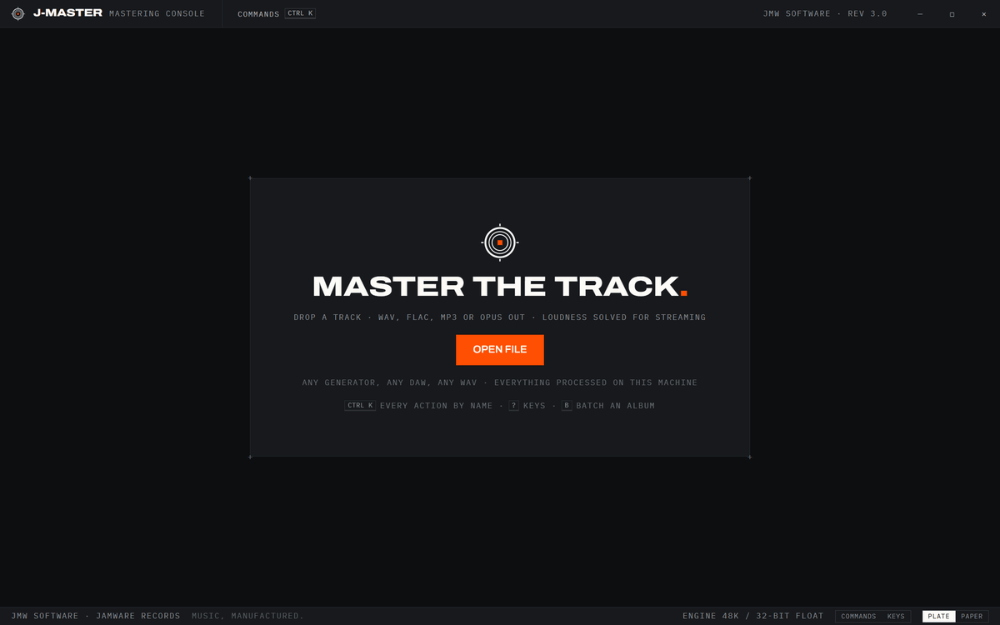
  <br/><sub>Drop a track in. It's decoded, measured, and split into sections in about a second.</sub>
</p>

**J-Master** is a desktop mastering console for Windows. It was built for the
output of AI music generators (SUNO, Udio, Riffusion, or local models like
MusicGen and Stable Audio), and it masters any track from any source, DAW
bounces included. Load a track and the console reads its tempo and its
sections, and checks it for the problems generated music tends to have: a
top end that stops short, bass smeared into the sides, dead air, a tempo
that drifts. Shape it with eight macro processors, or press one button and
let the analysis do it, with every decision shown. The whole master is
solved in the background as you work, so you hear the export's own level
and see where it will land before you render. Then export for any streaming
platform, tagged and with cover art, in several formats at once, with a
spec-sheet report, or assemble a whole album into a replication-ready CD
image.

Built by **[JMW Software](https://www.jmwsoftware.com.au)** for
**[Jamware Records](https://www.jamwarerecords.com)**. *Music, manufactured.*

<table>
  <tr>
    <td width="33%" valign="top"><b>Exact loudness</b><br/><sub>Measure, gain, true-peak limit, verify. Every export lands on its target with the ceiling held, and the console says where before you render.</sub></td>
    <td width="33%" valign="top"><b>Every decision shown</b><br/><sub>AUTO masters in one click and prints its reasoning. One more click undoes all of it.</sub></td>
    <td width="33%" valign="top"><b>Honest monitoring</b><br/><sub>Playback at the export's own gain. Split compare, loops over any stretch, loudness-matched bypass, mono and side checks, platform playback levels, a full meter rack.</sub></td>
  </tr>
  <tr>
    <td valign="top"><b>One render, every format</b><br/><sub>WAV, FLAC, MP3 and Ogg Opus at 44.1 or 48 kHz, with release tags, cover art and a spec-sheet report, several from a single pass.</sub></td>
    <td valign="top"><b>Whole albums</b><br/><sub>Drop a stack of tracks into BATCH, or assemble a CD image with a CUE sheet, ISRCs and CD-TEXT.</sub></td>
    <td valign="top"><b>Local and open</b><br/><sub>No account, no upload, no cloud. GPL-3.0, with the DSP, sample-rate converter, FLAC encoder and Opus muxer written in this repo, and 165 tests on the real code.</sub></td>
  </tr>
</table>

<table>
  <tr>
    <td width="50%">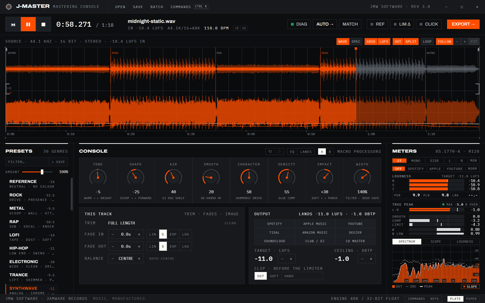</td>
    <td width="50%">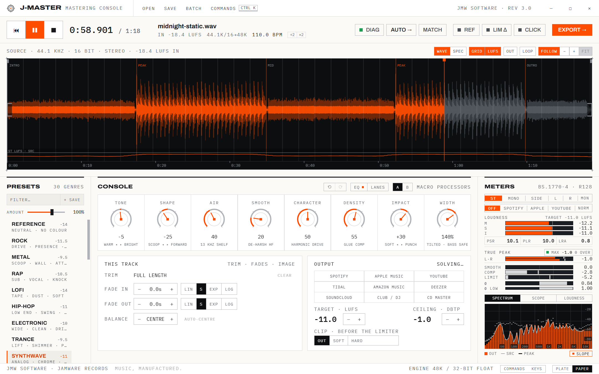</td>
  </tr>
  <tr>
    <td align="center"><sub><b>PLATE</b> · the mastering floor at night</sub></td>
    <td align="center"><sub><b>PAPER</b> · the spec sheet</sub></td>
  </tr>
</table>

<p align="center">
  <a href="#drop">Drop it in</a> ·
  <a href="#shape">Shape it</a> ·
  <a href="#listen">Hear it</a> ·
  <a href="#analysis">Let it listen</a> ·
  <a href="#ship">Ship it</a> ·
  <a href="#engine">Under the hood</a> ·
  <a href="#proof">Proof</a> ·
  <a href="#get">Get it</a> ·
  <a href="#license">License</a>
</p>

<a id="drop"></a>

Drop a track anywhere on the window. Before you let go, a veil says exactly
what the drop will do:

- **One track** loads into the console, and your console settings carry over
  to it.
- **Several tracks** queue in BATCH, mastered with the console as it stands.
  If the console is empty, the first one opens there too.
- **On MATCH**, a track becomes the reference. **On EXPORT or BATCH**, an
  image becomes the cover art.

Loading shows the file name and each analysis phase as it runs, and a file
that can't be decoded leaves the current track untouched. WAV, AIFF, FLAC,
MP3, Ogg (Vorbis and Opus) and M4A all load, at any sample rate: a file is
decoded at its own rate and brought to the engine's 48 kHz by the app's own
converter, not the browser's. The last six tracks reopen with one click from
the start screen, a `.jmaster` project restores a whole session, and a track
dropped on the app's shortcut opens in it.

<p align="center">
  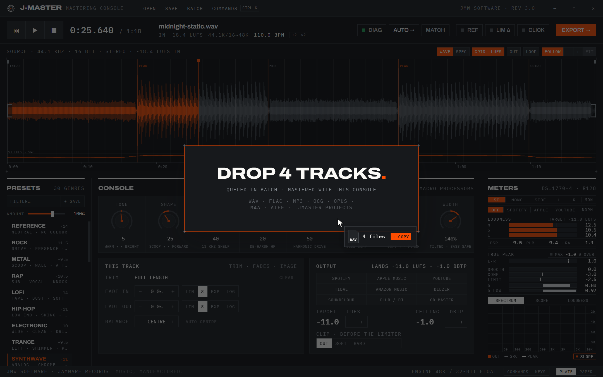
</p>

<a id="shape"></a>

<p align="center">
  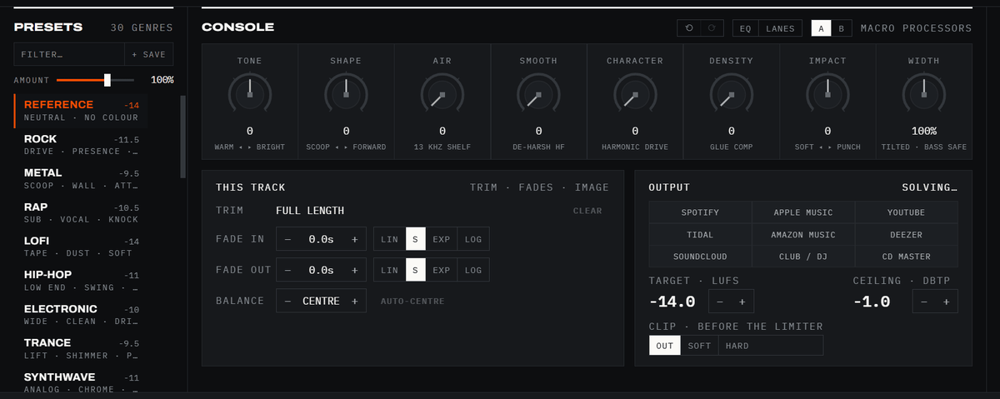
  <br/><sub>Pick a genre, tweak it (the rack marks it MODIFIED and offers REVERT), then keep it as your own.</sub>
</p>

Eight macro processors, tuned so that every knob does something musical and
none of them can ruin your track:

| Macro | What it does |
|---|---|
| **TONE** | Warm to bright spectral tilt, ±4.5 dB around 700 Hz |
| **SHAPE** | Scooped to forward mid contour (presence against wall-of-sound) |
| **AIR** | 13 kHz shelf, up to +6 dB of sheen |
| **SMOOTH** | *Dynamic* high-band tamer that cuts harsh AI-generation zing only when it appears; transparent otherwise |
| **CHARACTER** | 4× oversampled tanh saturation with even-harmonic bias for tape and tube colour at unity small-signal gain |
| **DENSITY** | Slow glue compression with auto-makeup: thickness, not pumping |
| **IMPACT** | Transient contour from soften to punch, ±6 dB on attacks |
| **WIDTH** | Stem-aware tilted M/S: bass anchored below 140 Hz, mids widened gently, highs opened most |

Thirty genre presets start you off. **AMOUNT** dials a preset in from none
of it to 150%, **+ SAVE** keeps the console (macros, target, ceiling, genre)
as a preset of your own, selectable per track in BATCH, and a pin keeps the
ones you use at the top of the rack. Around the macros:

- **LANES:** bass, drums, vocal and air trims of ±3 dB, built from shelves
  so a trim moves its band and never notches its neighbours.
- **AIR RESTORE:** most generators, and every MP3, stop short of 20 kHz. The
  check sheet finds where a source stops, and RESTORE grows a new top octave
  from the band below it, starting at the cut.
- **Advanced EQ:** six bands, each a shelf, a bell, a high-pass or a
  low-pass, acting on both channels, the MID only or the SIDE only. Drag the
  handles over the live spectrum, or type frequency, gain and Q in the
  band's inspector. The curve is drawn from the same filters the chain runs.
- **CLIP:** an optional soft or hard peak clipper ahead of the limiter, 4×
  oversampled. It takes the tallest peaks so the limiter doesn't pump for
  them.
- **A/B console slots** and full **undo and redo** (a step is undone in the
  slot it was made in).

One box holds the fixes that belong to this track alone: top and tail
**TRIM**, the fades and **BALANCE**. They never carry over to the next track
or ride along in a preset. Click any knob's readout to type an exact value,
hover one to learn what it does, or press <kbd>Ctrl</kbd>+<kbd>K</kbd> and
type what you want.

<p align="center">
  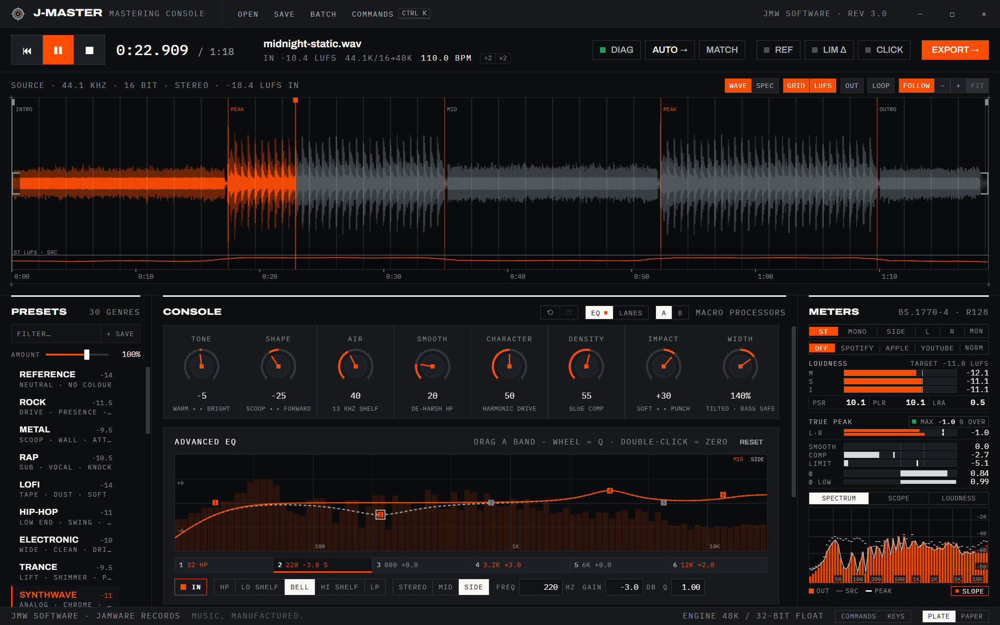
</p>

<p align="center">
  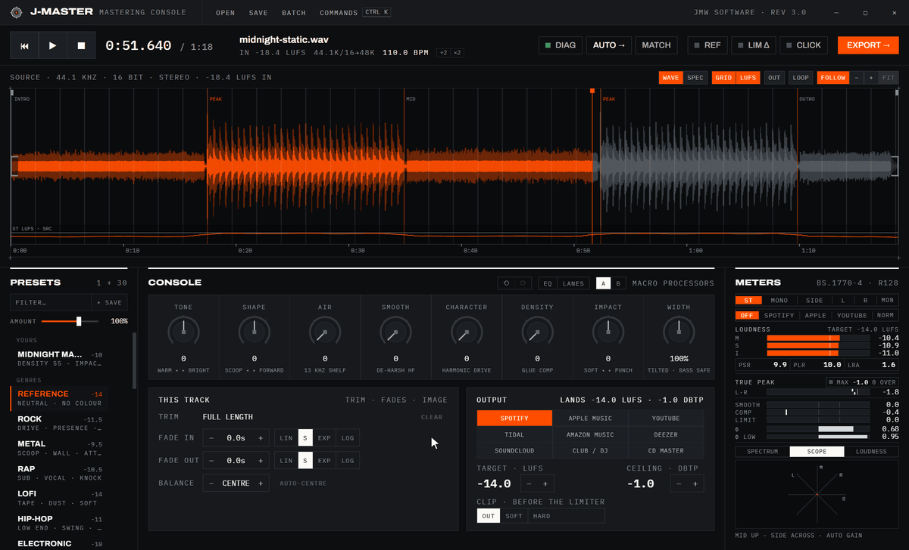
  <br/><sub><kbd>Ctrl</kbd>+<kbd>K</kbd> lists every action by name, with the key that does the same thing.</sub>
</p>

<a id="listen"></a>

<p align="center">
  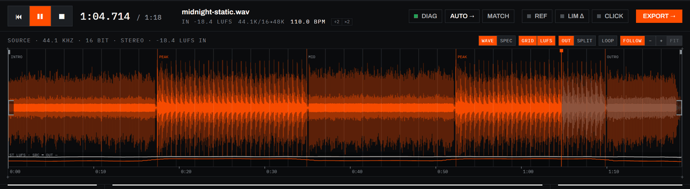
  <br/><sub>SPLIT puts the source above the master on one timeline; LOOP cycles the section you're working on.</sub>
</p>

<table>
  <tr>
    <td width="300" valign="top">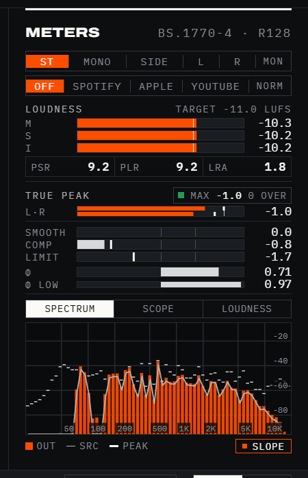</td>
    <td valign="top">

**Listen the way your audience will.**

- **What you hear is the export's level.** Each time the console settles,
  the whole track is solved in the background and playback takes that gain.
  The OUTPUT box shows where the master will land, and says so when a target
  can't be reached under the ceiling.
- **OUT** draws that master over the source as you adjust, and **SPLIT**
  stacks the two so the difference is visible at a glance.
- **LOOP** (<kbd>L</kbd>, or double-click the waveform) cycles the detected
  section under the playhead, sample-seamless. <kbd>Shift</kbd>+drag loops
  any stretch.
- **REF** is a loudness-matched bypass: tap <kbd>R</kbd> to switch, hold it
  for a momentary compare.
- **LIM Δ** plays only what the limiter removes.
- **MON** folds to mono, solos the side, or plays one channel, and the
  meters read exactly what you hear.
- **NORM** turns playback down as Spotify, Apple Music or YouTube would at
  your target, so a louder master and a more dynamic one can be judged at
  the level listeners get. Playback only; exports are untouched.
- **METERS** read momentary, short-term and integrated loudness with PSR,
  PLR and live LRA; true peak per channel with a latched maximum and an
  over-ceiling counter; gain reduction for every stage; and correlation for
  the whole band and for the bass alone, where a mono fold-down loses its
  low end.
- **SPECTRUM** is a real analyser (dB scale, peak hold, the source behind
  the master, a hover readout with note names), **SCOPE** plots the stereo
  image, and **LOUDNESS** draws the loudness history against the track with
  the target and where the export will land.

</td>
  </tr>
</table>

The waveform is a workspace too: wheel-zoom to transient level, drag the
**trim brackets** to cut dead air from either end (or press <kbd>[</kbd> and
<kbd>]</kbd> at the playhead), drag the fade handles (four curve shapes,
running from the trim points), overlay the bar and beat **GRID** with a
**CLICK** metronome (both follow the beats when a track drifts, until you
repair it), and flip to a log-frequency **spectrogram** that shares the same
zoom, grid, playhead and loudness lane. **FOLLOW** keeps the playhead in
view and steps aside while you look around.

<p align="center">
  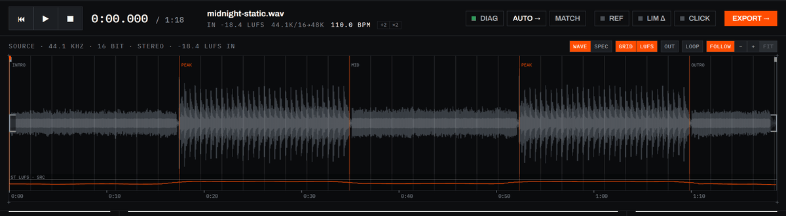
  <br/><sub>Top and tail with the brackets; <kbd>Shift</kbd>+drag loops any stretch.</sub>
</p>

<p align="center">
  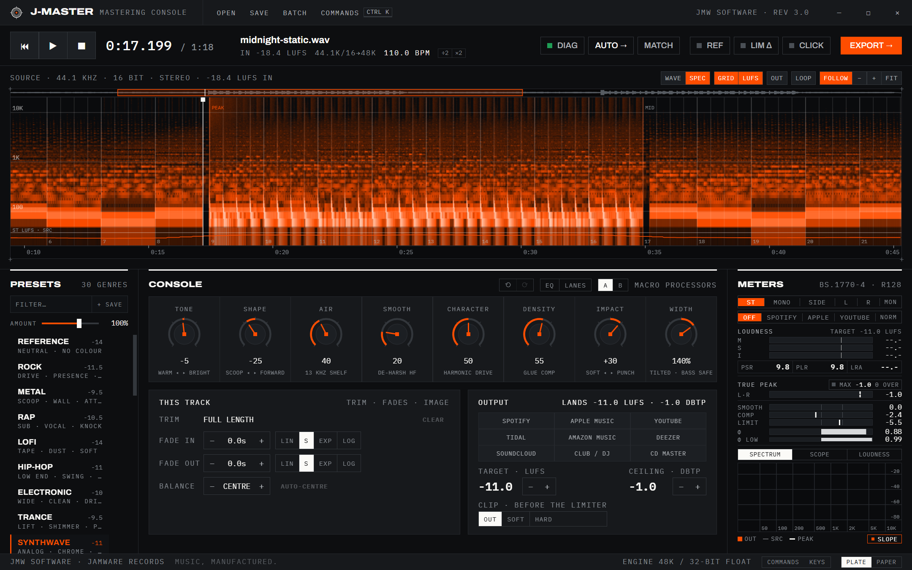
</p>

<a id="analysis"></a>

<p align="center">
  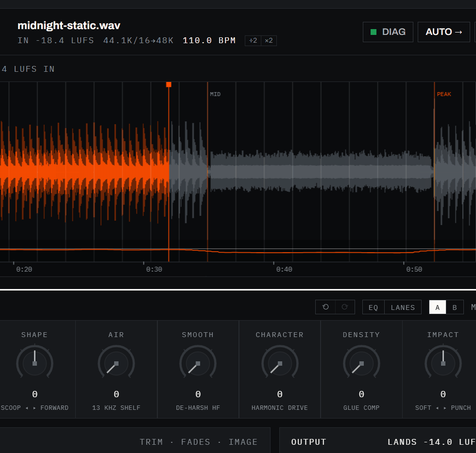
  <br/><sub>One click on AUTO: a preset chosen from the analysis, a target set, and every reason on the card.</sub>
</p>

Every load runs a full analysis pass:

- **Tempo detection:** spectral-flux onsets and autocorrelation, phase-locked
  to kick and bass, then beats tracked through the whole song. It drives the
  bar and beat **GRID** and the **CLICK** metronome (mixed in after metering
  and never exported). If the reading is an octave from how you feel the
  song, **÷2** and **×2** re-read it.
- **Tempo drift:** generated tracks often speed up or slow down as they
  play, so the tempo is measured through the song, not once. A drifting
  track is flagged with where the drift starts, how far it goes and how far
  a fixed grid slides off the beat; a **BPM** lane on the waveform shades
  exactly the stretch that drifts, and the GRID and CLICK follow the real
  beats instead of a grid that would slide off them.
- **Drift repair:** **REPAIR DRIFT** stretches the whole track onto one
  steady tempo (where the song sets out, its average, or any tempo you
  type), with pitch and stereo image unchanged, ready for DJ sets, video
  sync and tempo-synced effects. The dialog shows the new length and how far
  any part will stretch before anything runs. The repair then plays, masters
  and exports in place of the file, **REVERT** brings the file back, **SAVE
  WAV** writes the repair as a 32-bit float WAV, and a project re-runs it
  when it opens. The file on disk is never touched.
- **Section detection:** checkerboard novelty over band energies finds the
  boundaries, snaps them to bars (which also anchors bar 1 to the music), and
  labels each section by energy: INTRO, LOW, MID, PEAK, OUTRO.
- **Track diagnosis:** a ten-row check sheet tuned to what generated music
  gets wrong: a silent or out-of-phase side, bass smeared into the sides,
  phasey width, image lean, harsh highs, a top end that stops short, dead
  air before or after, a start or end cut mid-sound, clipping baked in
  before the file got here, and tempo drift. Each issue opens with its
  measured value and a one-click fix. Fixes that change the music itself (a
  fade-out) arrive unticked, and nothing is applied silently unless you arm
  **AUTO-FIX ON LOAD**.
- **Dynamics report:** PLR, EBU R128 loudness range, and a delivery table
  showing what Spotify, Apple Music, YouTube and Tidal normalization will do
  at your target.
- **AUTO →:** the one-button master. It picks a genre preset from tempo and
  spectral signature, dials it back on a source that arrives already dense,
  applies the diagnosed fixes, sets a target, and shows its complete
  reasoning, with one button to undo the lot.
- **MATCH:** load a reference track you trust; its tonal balance, loudness
  and width are measured against your source and a capped ±6 dB correction
  curve is applied in one click.

<p align="center">
  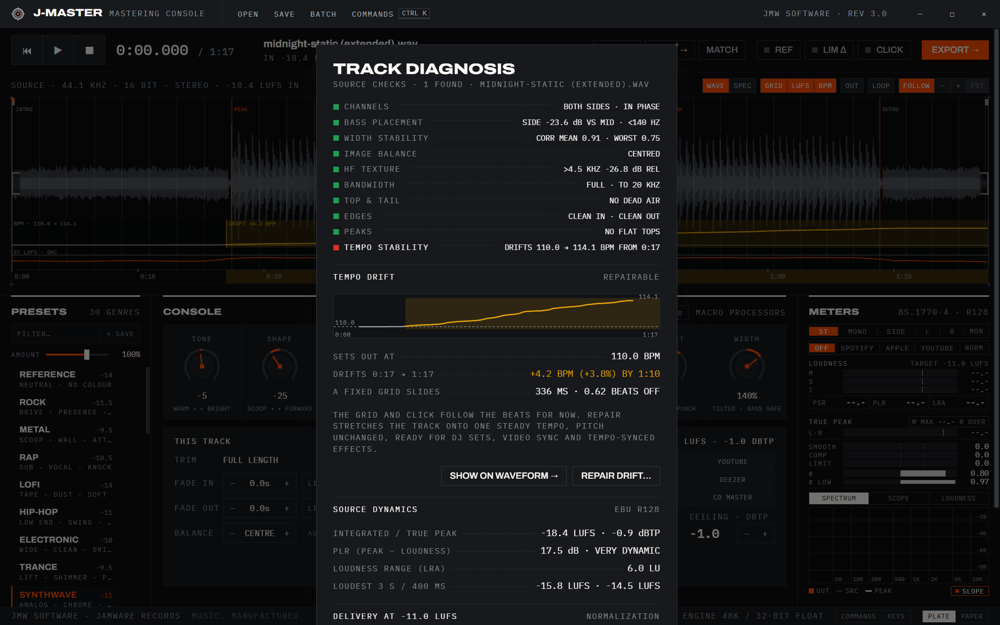
  <br/><sub>An extended take that runs away: steady at 110.0 BPM, then drifting from 0:17, flagged, charted and one click from a repair.</sub>
</p>

<p align="center">
  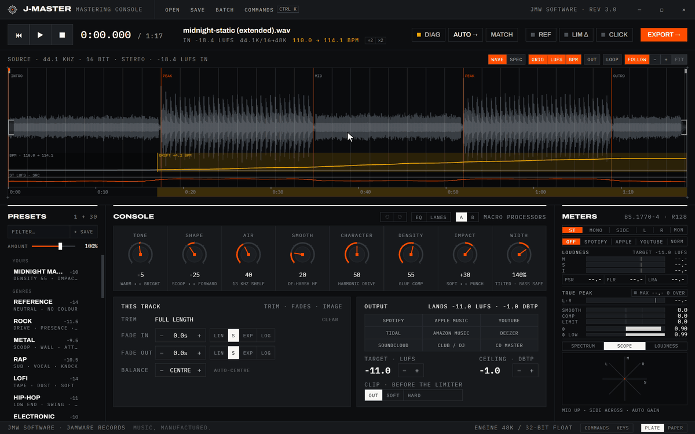
  <br/><sub>REPAIR DRIFT: the same take, stretched onto a steady 110 BPM in a few seconds. One fixed grid again, and the file on disk untouched.</sub>
</p>

<a id="ship"></a>

<table>
  <tr>
    <td width="440" valign="top">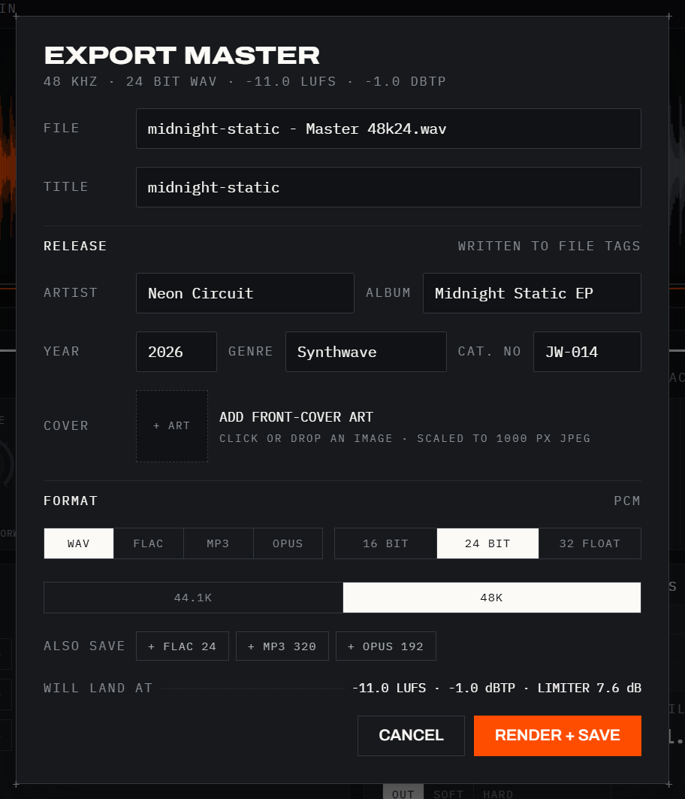</td>
    <td valign="top">

**One render, everything you deliver.**

The export pipeline solves loudness *exactly*: measure, gain, true-peak
limit, verify, iterating until the master lands on its target with the
ceiling held in dBTP. When a target can't be had under the ceiling, it stops
where more gain stops buying loudness and tells you, instead of crushing the
track toward a number.

- **ALSO SAVE** encodes extra formats from the same render and saves them
  beside the master: a WAV for distribution plus an MP3 for sharing is one
  loudness solve, one pass.
- **Cover art:** click or drop an image (scaled to a 1000 px JPEG) and it's
  embedded natively in every format.
- **Release tags:** title, artist, album, year, genre and catalog number,
  written in each container's own tag format.
- **Codec audition:** loop the loudest section and A/B the encoded result
  against the lossless master before you commit.
- **Lossy files are checked after encoding:** an MP3 or Opus file is decoded
  again and its true peak measured, because codecs overshoot. The export
  says when the file peaks over your ceiling.
- **REPORT:** a one-page spec sheet saved beside the master: what was
  measured, what the console did, how each platform will play it, and the
  waveform and loudness of the file.

</td>
  </tr>
</table>

| Format | Engine | Notes |
|---|---|---|
| **WAV** | in-house | 44.1 or 48 kHz; 16-bit (TPDF or noise-shaped dither), 24-bit or 32-bit float; RIFF INFO and ID3 tags |
| **FLAC** | **in-house (RFC 9639)** | 44.1 or 48 kHz, 16 or 24-bit; per-frame stereo decorrelation, LPC to order 12, partitioned Rice; MD5-signed, verified bit-exact lossless |
| **MP3** | lamejs (LGPL) | 320, 256 or 192 kbps CBR, ID3v2.3 tags, an Info frame for gapless, exact-length playback |
| **Ogg Opus** | **WebCodecs + in-house RFC 7845 muxer** | 256, 192 or 128 kbps, OpusTags metadata, zero dependencies |

A 44.1 kHz master is converted before the loudness solve, so the target and
the ceiling are solved on the very samples that ship.

<p align="center">
  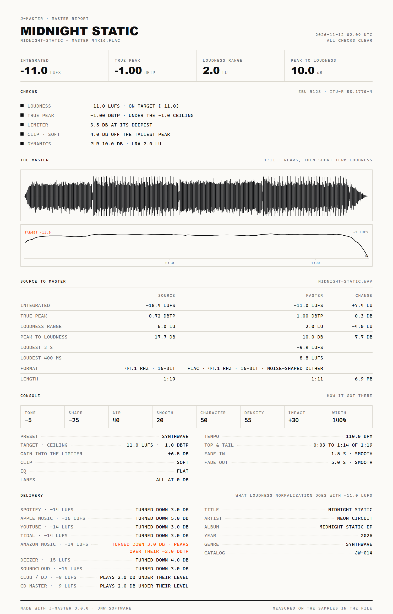
  <br/><sub>REPORT: one self-contained page per master. No scripts, nothing loaded from anywhere.</sub>
</p>

- **Cover art everywhere:** an ID3v2.3 APIC frame, a FLAC PICTURE block, Ogg
  Opus METADATA_BLOCK_PICTURE (the muxer spans pages when the art demands
  it), and a WAV `id3 ` chunk. Covers travel with projects and batch exports.
- **Batch albums:** queue tracks, reorder them, override presets per track,
  and number the tags automatically. Every track gets the console's sound
  and only the fixes its own scan found.
- **Album and CD assembly:** a replication-ready 44.1 kHz/16-bit image WAV
  (each track mastered straight to that rate and depth, frame-aligned,
  configurable gaps, streamed to disk) with a CUE sheet carrying CD-TEXT,
  per-track ISRCs and the album UPC, plus a manifest.
- **Projects:** save the whole session as a `.jmaster` file and double-click
  it to pick up exactly where you left off.

<a id="engine"></a>

The core guarantee is **WYSIWYG audio**: the real-time preview worklet and
the offline export renderer run the *same* TypeScript DSP code, bit for bit
at any block size, and the preview plays at the gain the export's own
loudness solve finds, so what you hear is what renders.

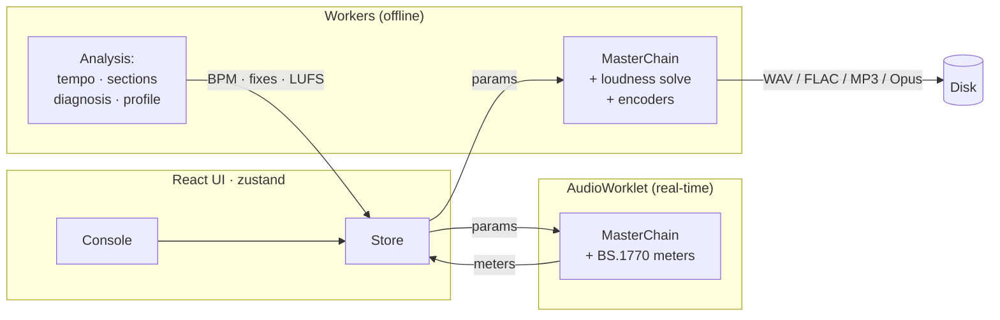

`src/audio/dsp/` is the shared engine: RBJ biquads, a 4× oversampler flat
to 20 kHz, saturator, harmonic air restore, glue compressor, transient
shaper, lanes, tilted M/S width, dynamic de-harsh, peak clipper, lookahead
true-peak limiter, a polyphase sample-rate converter, and a full BS.1770-4
implementation (K-weighting, gated integration, LRA, true peak). The FLAC
encoder, the Ogg Opus muxer and the AIFF reader are written from scratch in
this repo: no WASM blobs, no native modules. Deeper details live in
[docs/ARCHITECTURE.md](docs/ARCHITECTURE.md).

<a id="proof"></a>

Every claim here is measured, most of them on every commit: `npm test`
runs 165 tests on the real DSP, export path, worklet, codecs, analysis and
state, and the rest come from a scriptable hook (`window.__jmaster`) that
drives the real app.

| Claim | Measured |
|---|---|
| Export hits its loudness target | −11.49 LUFS on a −11.5 target; ffmpeg's EBU R128 meter reads −11.5, and −14.0, −16.0 and −9.0 on those targets, at 48 and 44.1 kHz |
| True-peak ceiling held | ffmpeg reads −1.0 dBFS true peak on a −1.0 ceiling at both rates; −0.99 at 16× oversampling with the limiter 20 dB into reduction |
| You are told when a target is out of reach | the demo track asked for −6.4 LUFS under a −1.0 dBTP ceiling: the solve stops at −8.0 LUFS, where more gain stops buying loudness, and says so |
| Loudness meter is BS.1770-4 | K-weighting equal to the standard's coefficients; the EBU Tech 3341 1 kHz reference reads −23.0 LUFS at 48 and 44.1 kHz; LRA matches the EBU Tech 3342 cases |
| Preview equals export | the chain at 128-sample (preview) and 4096-sample (export) blocks: bit-identical with every stage working; playback runs at the export's solved gain |
| Sample-rate conversion | 44.1 → 48 kHz: images more than 120 dB down, flat to 20 kHz, no delay; 44.1 → 48 → 44.1 returns the signal below −110 dB |
| Nothing notches | each lane trim moves its own band and never moves another the other way; WIDTH at 200% never narrows any frequency (its side channel used to dip 5.9 dB at 140 Hz) |
| CLIP takes the limiter's work | at a −9 LUFS target the limiter's deepest reduction drops by more than 3 dB with SOFT in, at the same loudness and ceiling |
| FLAC is lossless | ffmpeg decodes it bit-exact at 16 and 24 bits, 44.1 and 48 kHz, odd lengths included; STREAMINFO carries the audio's MD5 |
| ALSO SAVE is one render | a WAV and a FLAC from one export differ in 0 samples; WAV, FLAC and MP3 of one render all read −11.5 LUFS in ffmpeg |
| MP3 is gapless | decoded by ffmpeg: the length that went in, to the sample, and 0 samples of offset, at 320 kbps/48 kHz and 192 and 256 kbps/44.1 kHz |
| Lossy peaks are reported | a −1.0 dBTP master as 320 kbps MP3 decodes to −0.55 dBTP, as 192 kbps Opus to −0.31: the export sheet says so; loudness survives (−11.51 LUFS decoded against −11.5) |
| The check sheet finds what it says | a band-limited source's cut is found within 800 Hz; silence before the music within 20 ms; flat tops counted, and a clean sine or real music never flagged |
| BPM detection | 100.05 on a 100.00 BPM test track; 110.01 on the 110.00 BPM demo track; the grid lands within 11 ms of every true beat |
| Tempo drift detection | a +4% ramp, a +2.5% step and a ±1.2% wobble each flagged where it happens; steady tracks, drumless passages included, measure within ±0.03 BPM and are never flagged |
| CLICK follows the beat | every click on its beat through block edges, and a loop clicks its first beat on every lap |
| Drift repair lands on the grid | the drift demo (110.0 → 114.2 BPM) repaired to 110: its 145 true beats land within 3.6 ms of a steady 110 BPM grid (median; 9.1 ms at the 95th percentile), and it re-measures as a steady 110.0 BPM |
| Drift repair leaves the sound alone | a steady song repaired to its own tempo comes back unchanged (−145 dB, from the first sample); a bass note, a chord, a cluster and partials right on the 700 Hz band split keep their pitch within 0.1 cent and level within 0.3 dB |
| Section detection | demo track boundaries at 17.5, 34.9, 52.4 and 69.8 s; its bar lines fall at 17.45, 34.91, 52.36 and 69.82 s |
| CD image | each track mastered at 44.1 kHz/16-bit and padded to whole frames; a two-second gap is exactly 150 frames; the RIFF sizes patched to match |
| Cover art survives every container | APIC, PICTURE and METADATA_BLOCK_PICTURE parsed back from real renders; 657 KB of art spans 13 Ogg pages and still decodes |
| Settings cost nothing while idle | 200 meter frames write the saved settings 0 times (it used to be once per frame, 46 a second); a knob drag writes once |

<a id="get"></a>

**Download** the installer or the portable build, for x64 or ARM64, from the
[latest release](https://github.com/Jared-woodruff/J-Master/releases/latest).
The builds aren't code-signed yet, so Windows SmartScreen may warn on first
launch: choose **More info**, then **Run anyway**.

**Build from source** with Node 20 or newer:

```bash
npm install
npm test           # 165 tests on the real DSP, codecs, analysis and state
npm run dev        # renderer in a browser (http://localhost:5183)
npm run dev:app    # full Electron app against the Vite dev server
npm run dist       # Windows x64 installer + portable exe → release/
npm run dist:arm64 # Windows ARM64 builds (no native modules, same JS)
```

The renderer also runs standalone in a Chromium browser (file input and a
download fallback), which is how the automated verification drives it.

<details>
<summary><b>Keyboard map</b> (press <kbd>?</kbd> in the app for the same sheet)</summary>
<br/>

| Action | Keys |
|---|---|
| Every action, by name | <kbd>Ctrl</kbd> + <kbd>K</kbd> |
| Play / pause | <kbd>Space</kbd> |
| Return to start | <kbd>Home</kbd> |
| Seek 5 s / 30 s | <kbd>←</kbd> <kbd>→</kbd> / <kbd>Shift</kbd> + <kbd>←</kbd> <kbd>→</kbd> |
| Loop the section | <kbd>L</kbd> or double-click the waveform |
| Loop any stretch | <kbd>Shift</kbd> + drag on the waveform, or drag along the ruler |
| Trim start / end at the playhead | <kbd>[</kbd> / <kbd>]</kbd> |
| Reference (untouched source) | <kbd>R</kbd>; hold for a momentary compare |
| A/B console | <kbd>A</kbd> |
| Mono fold-down | <kbd>M</kbd> |
| Beat grid / follow the playhead | <kbd>G</kbd> / <kbd>F</kbd> |
| Source check sheet | <kbd>D</kbd> |
| Export / batch | <kbd>E</kbd> / <kbd>B</kbd> |
| Close the open sheet | <kbd>Esc</kbd> |
| Save / open a project | <kbd>Ctrl</kbd> + <kbd>S</kbd> / <kbd>Ctrl</kbd> + <kbd>O</kbd> |
| Undo / redo | <kbd>Ctrl</kbd> + <kbd>Z</kbd> / <kbd>Ctrl</kbd> + <kbd>Y</kbd> |
| Fine knob drag | <kbd>Shift</kbd> + drag |
| Reset a knob | double-click, or <kbd>Home</kbd> |
| Type a knob value | click its readout |
| Walk the presets | <kbd>↑</kbd> <kbd>↓</kbd> in the rack |
| Zoom / pan the waveform | wheel / <kbd>Shift</kbd> + wheel |
| Load a track | drop it anywhere |
| Queue an album | drop several tracks |

</details>

<details>
<summary><b>Regenerating the README media</b></summary>
<br/>

Every screenshot and GIF on this page comes from the app itself, playing a
demo track synthesized by `scripts/make-demo-song.mjs` (a 110 BPM cue in
clean 8-bar sections). The capture scripts drive the production build with
real drops, clicks and keystrokes, on a throwaway profile with audio muted.

```bash
node scripts/make-banners.mjs      # animated banners; type set as vector paths
npm run build
node scripts/capture-screens.mjs   # screenshots (the report shot needs Microsoft Edge)
node scripts/capture-media.mjs     # GIFs (needs ffmpeg on PATH)
```

The scripts open the app without taking the keyboard focus, so you can keep
working while they run.

GitHub serves repository SVGs under a policy that blocks fonts, so the
banners set their type as paths from `scripts/banner-glyphs.json`, which
`scripts/build-glyph-atlas.py` extracts from the app's bundled fonts (only
needed when a banner uses a new character). Banner motion is CSS only and
stops for anyone with reduced motion turned on.

</details>

> **Windows packaging note:** if electron-builder fails with `EPERM` renaming
> `win-unpacked.tmp`, something (usually an editor's file watcher) is holding
> directory handles in the project tree. Build to an outside folder:
> `npx electron-builder --win --x64 "-c.directories.output=%TEMP%\jm-release"`

<a id="license"></a>

**GPL-3.0:** see [LICENSE](LICENSE).

Copyright © 2026 **JMW Software** and **Jamware Records**. J-Master is
genuinely open source; copyleft keeps derivatives open, while all copyright
in the software, its design language, and the J-Master, JMW Software and
Jamware Records names and marks remains with the companies. The GPL covers
the code; it does not grant rights to the brand.

Third-party notice: MP3 encoding uses
[@breezystack/lamejs](https://www.npmjs.com/package/@breezystack/lamejs)
(LGPL-3.0). All other DSP, the sample-rate converter, the FLAC encoder, the
Ogg Opus muxer and the AIFF reader are original to this repository. UI set in the Jamware Records design language
(Archivo and IBM Plex Mono, bundled under the Open Font License).

<p align="center">
  <sub>JMW SOFTWARE · JAMWARE RECORDS · MUSIC, MANUFACTURED.</sub>
</p>
